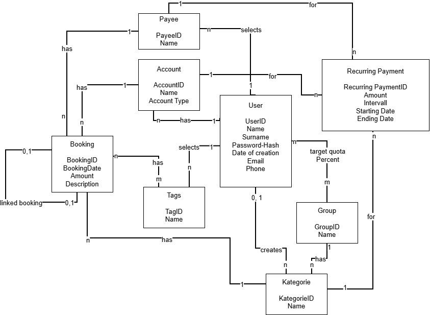

# Expense Tracker Database

A relational database for personal finances: accounts, bookings, categories, tags, recurring payments and a budget check against the 50/30/20 rule. Built for MariaDB.

It began as a school project in June 2023 and was redesigned from scratch in 2026, starting with the requirements and an ER model and ending with tested SQL. The steps are written down in [design.md](design.md).



## What it can answer

Did two people keep to their targets of 50 % needs, 30 % wants and 20 % savings in October? (query 3 in [queries.sql](queries.sql))

```
+------------+------------+---------+----------------+----------------+------------+
| first_name | group_name | amount  | actual_percent | target_percent | difference |
+------------+------------+---------+----------------+----------------+------------+
| Lena       | Needs      | 1000.00 |           50.0 |          50.00 |        0.0 |
| Lena       | Wants      |  600.00 |           30.0 |          30.00 |        0.0 |
| Lena       | Savings    |  400.00 |           20.0 |          20.00 |        0.0 |
| Jonas      | Needs      | 1540.00 |           55.0 |          50.00 |        5.0 |
| Jonas      | Wants      |  980.00 |           35.0 |          30.00 |        5.0 |
| Jonas      | Savings    |  280.00 |           10.0 |          20.00 |      -10.0 |
+------------+------------+---------+----------------+----------------+------------+
```

What is on every account? The balance is not stored anywhere. It is the sum of the bookings (query 1).

```
+------------+-------------------+--------------+---------+
| first_name | account_name      | account_type | balance |
+------------+-------------------+--------------+---------+
| Lena       | Checking          | checking     |  980.60 |
| Lena       | Rainy-day savings | savings      |  500.00 |
| Lena       | Brokerage         | investment   |  150.00 |
| Jonas      | Checking          | checking     |  700.00 |
| Jonas      | Credit card       | credit_card  | -700.00 |
| Jonas      | Savings           | savings      |  280.00 |
| Mia        | Checking          | checking     |    0.00 |
| Mia        | Wallet            | cash         |    0.00 |
+------------+-------------------+--------------+---------+
```

The other queries: spending per category, everything with a certain tag, transfers as one line each, the biggest payees, monthly fixed costs, and the categories a user can choose from.

## Files

| File | Content |
|---|---|
| [schema.sql](schema.sql) | 10 tables, 2 views, 1 trigger, the four groups and 15 default categories |
| [seed.sql](seed.sql) | invented example data: 3 users, 8 accounts, 46 bookings |
| [queries.sql](queries.sql) | 8 commented example queries |
| [tests/checks.sql](tests/checks.sql) | 13 statements the database must reject, and 6 checks of what happens on delete |
| [design.md](design.md) | requirements, ER model, relational model, normalisation |
| [docs/](docs) | the ER diagram as an image and as a draw.io file |

## Run it

You need MariaDB 10.2.1 or newer, because older versions ignore CHECK constraints. XAMPP includes MariaDB. Tested on MariaDB 10.11.

**With phpMyAdmin:** open `http://localhost/phpmyadmin`, go to *Import*, and import `schema.sql` and then `seed.sql`. Paste the queries from `queries.sql` into the *SQL* tab.

**On the command line**, from this folder (with XAMPP the program is `C:\xampp\mysql\bin\mysql.exe`):

```bash
mysql -u root -e "source schema.sql"
mysql -u root -e "source seed.sql"
mysql -u root --table -e "source queries.sql"
mysql -u root --force --table -e "source tests/checks.sql"
```

The last command prints 13 error messages, one for each statement that was rejected as intended, followed by seven lines that must all say `PASS`.

`schema.sql` deletes the database `expense_tracker` and builds it again, so it can be run as often as you like.

## Design decisions

- **Amounts are `DECIMAL(12,2)`, never `FLOAT`.** Floating-point numbers cannot store 0.10 exactly, and the rounding errors add up.
- **One amount column with a sign.** Negative is money out, positive is money in. The balance of an account is then a plain `SUM`.
- **No balance column.** The view `account_balances` calculates it, so it cannot go out of date.
- **A booking has no `user_id`.** Its owner is the owner of its account. Storing it twice would allow contradictions (third normal form).
- **A transfer is two bookings that point at each other.** Money leaves one account and arrives on another, and both accounts show it. `UNIQUE` on the link keeps it one-to-one, and deleting one half deletes the other.
- **Saving is a transfer.** Moving 250 to the savings account is not an expense. The budget view counts the outgoing half under "Savings" and skips the incoming half, so that the two do not cancel out.
- **Default categories have no owner.** `categories.user_id` is empty for the 15 categories everyone can use and set for a user's own.
- **Payees are a table, not a text field.** "Supermarket" exists once per user, so "how much did I pay them" is an exact question.
- **Passwords are stored as hashes.** The column is `password_hash`, filled with the output of PHP's `password_hash()`.
- **`ON DELETE` is chosen per relationship**: cascade for things a user owns, set-to-empty for payees, refuse for categories in use. The table is in [design.md](design.md#6-what-happens-on-delete).
- **One composite index, `(account_id, booking_date)`.** Most questions are about one account in one period. The queries filter with `date >= ... AND date < ...` so the index can be used.

## Limitations

- **Strict SQL mode is assumed.** It is MariaDB's default. Without it, MariaDB stores an unknown account type as an empty string and a missing date as `0000-00-00`, with only a warning. Check with `SELECT @@sql_mode;` that `STRICT_TRANS_TABLES` is listed. The test file switches it on for its own session.
- **Rules across users are not enforced.** The database does not stop a booking on one user's account from using another user's category, payee or tag. An application has to check that.
- **The two halves of a transfer are not compared.** Nothing checks that the amounts are opposite, the dates equal and both accounts belong to the same user.
- **Target quotas are not added up.** Each must be between 0 and 100, but nothing forces a user's quotas to sum to 100.
- **Every booking needs a category from one of the four groups.** A neutral movement, such as withdrawing cash or paying off a credit card, has no natural place yet. A fifth group that the budget ignores would solve it.
- **Default categories can be duplicated.** `UNIQUE (user_id, name)` does not cover rows without a user, because every empty value counts as different.
- **One currency.**

## Possible next steps

- a stored procedure that creates both halves of a transfer in one transaction
- budgets per category and month
- a small PHP front end with login
