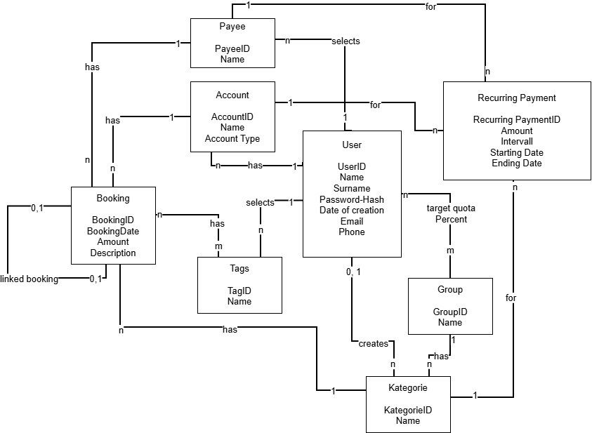

# Expense Tracker: Design

How the database was designed, from the requirements to the tables.

## 1. Requirements

1. Several users, each with their own login (e-mail and password).
2. A user has several accounts. Account types: checking, savings, cash, credit card, investment.
3. A booking belongs to one account and has an amount, a date, a description and a payee.
4. A booking is income, an expense or a transfer between two of the user's own accounts. Saving counts as a transfer.
5. Every booking has exactly one category. Every category belongs to one group: Income, Needs, Wants or Savings.
6. There are default categories for everyone, and every user can add their own.
7. Every user sets a target share per group, for example 50 / 30 / 20.
8. Payees (supermarket, landlord, ...) are stored once per user and reused by bookings.
9. A booking can have any number of tags. Every user creates their own tags.
10. Recurring payments (rent, subscriptions, salary) have an amount, an account, a category, a payee, a frequency, a start date and an optional end date.

## 2. Entities

| Entity | Attributes |
|---|---|
| User | UserID, Name, Surname, Email, Password-Hash, Date of creation, Phone |
| Account | AccountID, Name, Account Type |
| Booking | BookingID, BookingDate, Amount, Description |
| Recurring Payment | RecurringPaymentID, Amount, Interval, Starting Date, Ending Date |
| Category | CategoryID, Name |
| Group | GroupID, Name |
| Payee | PayeeID, Name |
| Tag | TagID, Name |

## 3. Relationships

| Relationship | Cardinality | Note |
|---|---|---|
| User has Account | 1 : n | |
| User creates Category | 0..1 : n | a category without a user is a default category |
| User creates Tag | 1 : n | |
| User creates Payee | 1 : n | |
| User sets target quota for Group | n : m | attribute: Percent |
| Group contains Category | 1 : n | |
| Account has Booking | 1 : n | |
| Booking has Category | n : 1 | |
| Payee has Booking | 0..1 : n | a transfer has no payee |
| Booking has Tag | n : m | |
| Booking is linked to Booking | 0..1 : 0..1 | the two halves of a transfer |
| Recurring Payment for Account | n : 1 | |
| Recurring Payment for Category | n : 1 | |
| Recurring Payment for Payee | n : 0..1 | |

## 4. Relational model

Primary keys are **bold**, foreign keys are marked with ↑.

- users(**user_id**, first_name, last_name, email, password_hash, phone, created_at)
- category_groups(**group_id**, name)
- accounts(**account_id**, name, account_type, ↑user_id)
- categories(**category_id**, name, ↑group_id, ↑user_id)
- payees(**payee_id**, name, ↑user_id)
- tags(**tag_id**, name, ↑user_id)
- bookings(**booking_id**, booking_date, amount, description, ↑account_id, ↑category_id, ↑payee_id, ↑linked_booking_id)
- recurring_payments(**recurring_payment_id**, amount, frequency, start_date, end_date, ↑account_id, ↑category_id, ↑payee_id)
- booking_tags(**↑booking_id, ↑tag_id**)
- target_quotas(**↑user_id, ↑group_id**, percent)

How the tables follow from the ER model:

| Rule | Applied to |
|---|---|
| Every entity becomes a table. | the first eight tables |
| 1 : n: the "n" side gets a foreign key. | accounts.user_id, categories.group_id, bookings.account_id, bookings.category_id and the others |
| If the "1" side is optional (0..1), the foreign key may be empty. | categories.user_id (empty = default category), bookings.payee_id, recurring_payments.payee_id |
| n : m becomes a table of its own. Its primary key is the pair of foreign keys, and an attribute of the relationship moves into it. | booking_tags, target_quotas (with percent) |
| A 1 : 1 relationship of a table with itself becomes a foreign key to the same table, with UNIQUE so that it stays 1 : 1. | bookings.linked_booking_id |

Names changed on the way to SQL: `Group` and `Interval` are reserved words, so the table is called `category_groups` and the column `frequency`.

## 5. Normalisation

**Why does a booking have no user_id?** The owner of a booking is the owner of its account. A user_id in `bookings` would store the same fact a second time, and the two could contradict each other (third normal form: no attribute depends on another non-key attribute).

**Is anything stored twice?** No. In particular there is no balance column: the balance of an account is the sum of its bookings and is calculated by a view. A stored balance could go out of date.

**Which foreign keys may be empty?**

| Column | Empty means |
|---|---|
| categories.user_id | default category for everyone |
| bookings.payee_id | no payee, for example a transfer |
| bookings.linked_booking_id | not a transfer |
| recurring_payments.payee_id | no payee |

## 6. What happens on delete

| When this is deleted | this happens | Why |
|---|---|---|
| a user | everything the user owns is deleted | personal data should not stay behind |
| an account | its bookings and recurring payments are deleted | they make no sense without the account |
| one half of a transfer | the other half is deleted too | half a transfer would look like income or an expense |
| a payee | bookings stay, their payee becomes empty | the history must not disappear with the payee |
| a tag | it is removed from its bookings | the bookings themselves are unaffected |
| a category or group that is in use | refused | otherwise bookings would lose their category |
